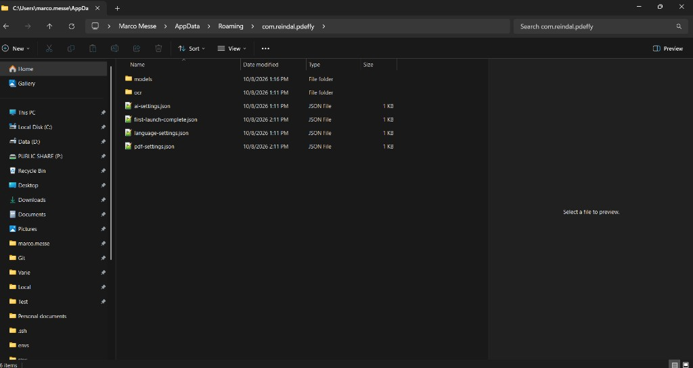
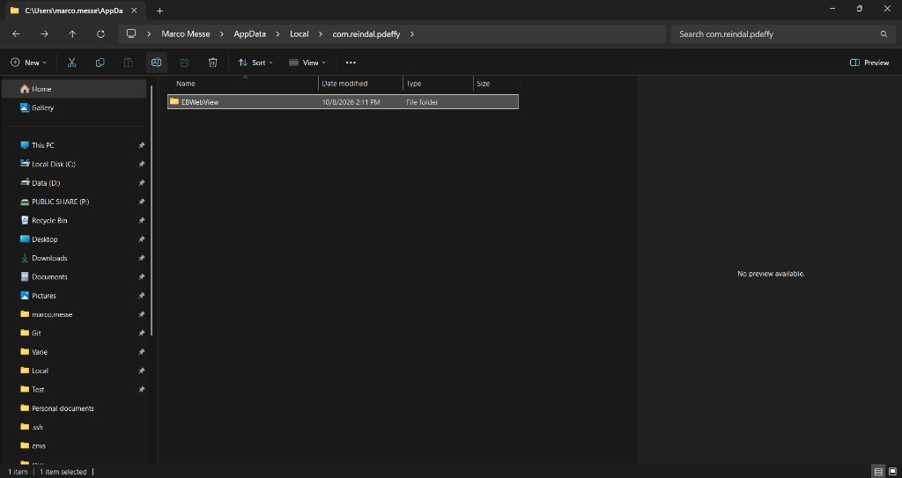
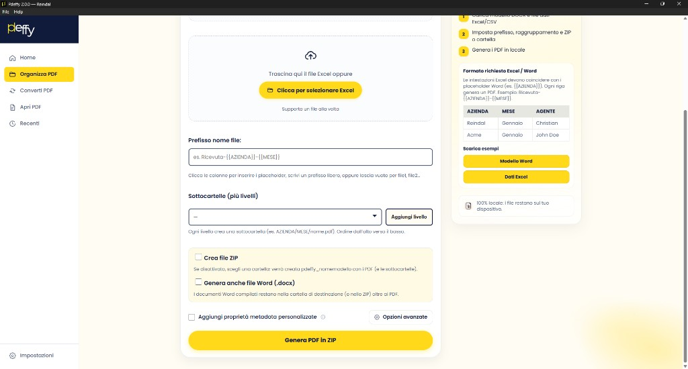
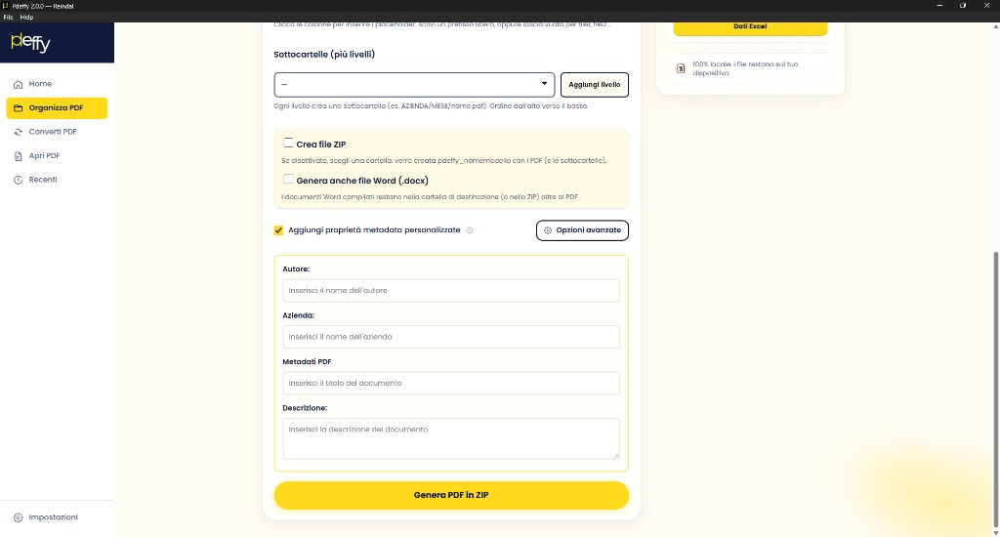
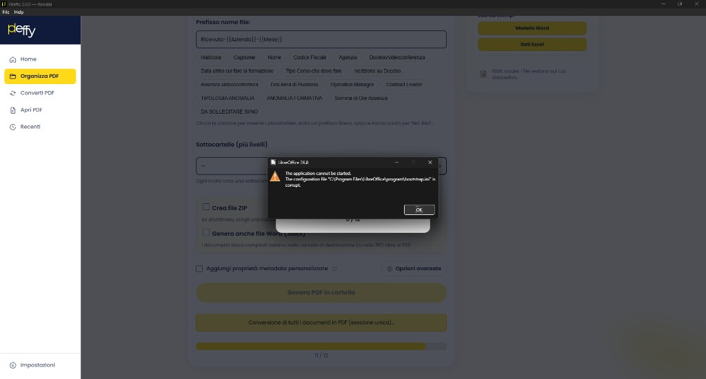
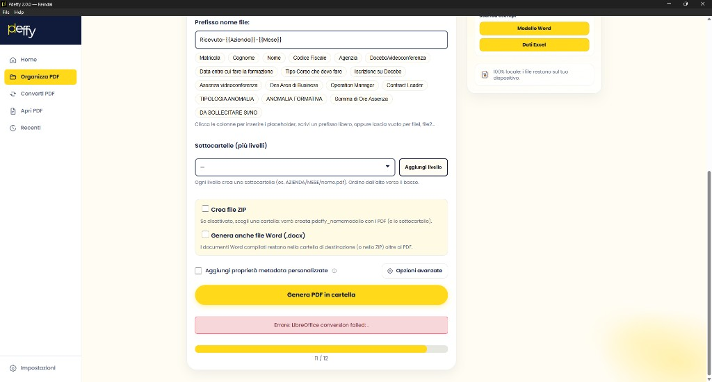

# QA Bugs — Pdeffy

Registro bug trovati in test. Aggiornato mano a mano durante le sessioni di QA.

**Come usarlo:** dimmi il bug (e se vuoi: area, severity, step, ipotesi di causa). Se alleghi screenshot o video li salvo in `docs/qa-bugs/assets/` e li collego qui.

**Allegati:**
- Media in `assets/` (stessa cartella del tracker).
- **Screenshot** → incorporati inline con ``.
- **Video** → salvati come file e collegati con link (Markdown non li riproduce inline in modo affidabile). Preferire clip corte; se pesano troppo, link esterno + frame chiave opzionale.

**Versione app:** quella dell’installer / app installata che stai testando — **me la dici tu** (non si legge dal codice locale). Se te la scordi, te la chiedo prima di chiudere la scheda.

---

## Riepilogo

| ID | Versione | Area | Titolo | Severity | Stato | Ipotesi |
|----|----------|------|--------|----------|-------|---------|
| BUG-001 | 2.0.0 | Setup / GLiNER | Progress download supera i 200 MB (size label errata) | minor | aperto | sì |
| BUG-002 | 2.0.0 | Installer / Uninstall | Residui AppData dopo disinstallazione | major | aperto | sì |
| BUG-003 | 2.0.0 | Setup / First launch | Wizard setup assente dopo reinstall | major | aperto | sì |
| BUG-004 | 2.0.0 | PDF da modello / Metadata | Checkbox e Opzioni avanzate ridondanti; info senza tooltip | minor | aperto | sì |
| BUG-005 | 2.0.0 | PDF da modello | Label submit ZIP errata al primo load | minor | aperto | sì |
| BUG-006 | 2.0.0 | PDF da modello / LibreOffice | Conversione fallisce (alert LO + errore vuoto) | critical | aperto | sì |

**Legenda stato:** `aperto` · `in corso` · `fixato` · `verificato` · `wontfix` · `duplicato`  
**Legenda severity:** `blocker` · `critical` · `major` · `minor` · `cosmetic`

---

## Bug

### BUG-001 — Progress download GLiNER supera i 200 MB

| Campo | Valore |
|-------|--------|
| Versione | 2.0.0 *(app installata — dichiarata dal tester)* |
| Area | Setup / Anonimizzazione (GLiNER) |
| Severity | minor |
| Stato | aperto |
| Data | 2026-10-08 |
| Ambiente | Windows, app installata da installer |

**Descrizione**

Durante lo step 5/7 del setup wizard (“Anonimizzazione”), il progresso del download GLiNER mostra un totale fisso di 200 MB. I byte scaricati superano quel totale (es. `239.2 MB / 200.0 MB (100%)`), quindi la barra/percentuale non riflette la realtà.

**Passi per riprodurre**

1. Avviare Pdeffy 2.0.0 installata e aprire il setup wizard.
2. Arrivare allo step Anonimizzazione (5/7).
3. Avviare “Scarica GLiNER”.
4. Osservare la riga di progresso durante/dopo il download.

**Atteso**

Totale e percentuale coerenti con la dimensione reale del pack (o almeno un totale aggiornato / “sconosciuto” se Content-Length non è affidabile).

**Osservato**

Progress tipo `Download GLiNER.. 239.2 MB / 200.0 MB (100%)` mentre il download continua oltre i 200 MB. La cartella installata `gliner_multi-v2.1-onnx` pesa ~352 MB su disco.

**Screenshot**

**Ipotesi / pista per il fix**

Il totale ~200 MB è hardcoded e sottostimato rispetto al pack reale (~350 MB). Nel codice locale compare come `NER_PACK_SIZE_LABEL` / `NER_PACK_EXPECTED_BYTES` in `src-tauri/src/ai/anonymize/ner/config.rs`, più le stringhe UI in setup/settings/`changeLang.js`. Va allineato il totale (e le copy “~200 MB”) alla size reale del modello, oppure usare Content-Length / size su disco.

**Note**

—

### BUG-002 — Residui in AppData dopo disinstallazione

| Campo | Valore |
|-------|--------|
| Versione | 2.0.0 *(app installata — dichiarata dal tester)* |
| Area | Installer / Uninstall |
| Severity | major |
| Stato | aperto |
| Data | 2026-10-08 |
| Ambiente | Windows, disinstallazione da app installata via installer |

**Descrizione**

Dopo aver disinstallato Pdeffy restano due cartelle `com.reindal.pdeffy` non rimosse:

1. `%AppData%\Roaming\com.reindal.pdeffy` — modelli scaricati (`models` / GLiNER, `ocr`), più file di config (`ai-settings.json`, `first-launch-complete.json`, `language-settings.json`, `pdf-settings.json`).
2. `%AppData%\Local\com.reindal.pdeffy` — contiene `EBWebView` (cache/dati WebView2) con altre sottocartelle.

In particolare i modelli in Roaming possono occupare centinaia di MB dopo la rimozione dell’app.

**Passi per riprodurre**

1. Installare Pdeffy e completare il setup (download OCR / GLiNER).
2. Disinstallare l’applicazione con il disinstaller Windows.
3. Controllare `%AppData%\Roaming\com.reindal.pdeffy` e `%AppData%\Local\com.reindal.pdeffy`.

**Atteso**

Disinstallazione pulita: rimozione (o almeno proposta di rimozione) di dati utente/modelli/cache legati all’app, oppure checkbox esplicita “Mantieni impostazioni e modelli”.

**Osservato**

Entrambe le cartelle restano sul disco dopo la disinstallazione.

**Screenshot**

**Ipotesi / pista per il fix**

L’hook NSIS `NSIS_HOOK_POSTUNINSTALL` in `src-tauri/windows/installer-hooks.nsh` oggi fa solo deregistrazione del gestore PDF (`un.PdeffyUnregisterPdfHandler`) e non cancella `$APPDATA` / `$LOCALAPPDATA` di `com.reindal.pdeffy`. Va aggiunto cleanup (con attenzione a non cancellare dati se l’utente vuole conservarli — idealmente checkbox in uninstall).

**Note**

Effetto collaterale: vedi **BUG-003** (wizard setup non riparte dopo reinstall).

---

### BUG-003 — Wizard di setup iniziale non mostrato dopo reinstall

| Campo | Valore |
|-------|--------|
| Versione | 2.0.0 *(app installata — dichiarata dal tester)* |
| Area | Setup / First launch |
| Severity | major |
| Stato | aperto |
| Data | 2026-10-08 |
| Ambiente | Windows, reinstall dopo disinstallazione (stesso utente) |
| Dipende da | BUG-002 |

**Descrizione**

Dopo aver disinstallato e reinstallato Pdeffy, il wizard di setup iniziale non viene mostrato. L’app parte come se la configurazione fosse già stata completata.

**Passi per riprodurre**

1. Installare Pdeffy, completare (o almeno avviare) il setup fino a creare i file in AppData.
2. Disinstallare l’app (lasciando i residui di BUG-002).
3. Reinstallare Pdeffy e avviarla.

**Atteso**

Dopo una disinstallazione “pulita”, il primo avvio dovrebbe di nuovo mostrare il wizard di setup. Se si scelgono di conservare i dati utente, il comportamento “salta wizard” può essere accettabile ma dovrebbe essere esplicito.

**Osservato**

Nessun wizard di setup al reinstall; l’app usa ancora modelli/settings residui.

**Screenshot**

—

**Ipotesi / pista per il fix**

Conseguenza diretta di BUG-002: resta `%AppData%\Roaming\com.reindal.pdeffy\first-launch-complete.json` (e gli altri settings). `check-first-launch` in `src-tauri/src/commands/settings.rs` guarda quel file; se esiste, il first-launch/wizard non riparte. Fix primario: cleanup (o scelta utente) in uninstall; in alternativa, rivalutare first-launch anche in base a version/install id.

**Note**

—

### BUG-004 — Checkbox metadata e “Opzioni avanzate” ridondanti; icona info senza tooltip

| Campo | Valore |
|-------|--------|
| Versione | 2.0.0 *(app installata — dichiarata dal tester)* |
| Area | PDF da modello / Metadata UI |
| Severity | minor |
| Stato | aperto |
| Data | 2026-10-08 |
| Ambiente | Windows, app installata |

**Descrizione**

Nella tool “PDF da modello”, la checkbox **Aggiungi proprietà metadata personalizzate** e il bottone **Opzioni avanzate** aprono lo stesso pannello campi metadata. Si può richiudere solo deselezionando la checkbox (il bottone non fa toggle). Inoltre l’icona **i** accanto alla label non mostra un tooltip utile: un click su di essa seleziona/deseleziona la checkbox come se facesse parte della label.

**Passi per riprodurre**

1. Aprire Organizza PDF → PDF da modello (o tool con metadata UI).
2. Cliccare “Opzioni avanzate” → si apre il pannello metadata e si spunta la checkbox.
3. Cliccare di nuovo “Opzioni avanzate” → il pannello resta aperto (nessun close).
4. Chiudere solo deselezionando la checkbox.
5. Cliccare l’icona info (i) vicino alla label → toggla la checkbox; nessun tooltip chiaro.

**Atteso**

Un solo controllo per aprire/chiudere il pannello, oppure due controlli con ruoli distinti (es. checkbox = abilita metadata in export; bottone = expand/collapse). L’icona info dovrebbe mostrare un tooltip/help e non togglare la checkbox.

**Osservato**

Due entry point ridondanti; chiusura solo via checkbox; info icon si comporta come parte della label.

**Screenshot**

**Video**

—

**Ipotesi / pista per il fix**

In `src/ui/toolWorkspace.js` → `wireMetadataToolbar`:
- il bottone `.pdeffy-ws-advanced` **solo spunta** la checkbox (non fa uncheck/toggle);
- l’icona `.pdeffy-ws-info` viene inserita **dentro** `<label class="metadataCheckboxLabel">`, quindi il click attiva il checkbox; `title="Metadata"` non è un help localizzato.

Probabile fix UX: tenere solo checkbox *oppure* solo “Opzioni avanzate” (toggle), e spostare l’info fuori dalla `<label>` con tooltip/help reale.

**Note**

—

### BUG-005 — Label submit “Genera PDF in ZIP” errata al primo load

| Campo | Valore |
|-------|--------|
| Versione | 2.0.0 *(app installata — dichiarata dal tester)* |
| Area | PDF da modello |
| Severity | minor |
| Stato | aperto |
| Data | 2026-10-08 |
| Ambiente | Windows, app installata |

**Descrizione**

Nella tool PDF da modello, la checkbox **Crea file ZIP** è off di default, ma il bottone parte con la label **Genera PDF in ZIP**. Dopo il primo toggle della checkbox, l’aggiornamento dinamico funziona correttamente.

**Passi per riprodurre**

1. Aprire Organizza PDF → PDF da modello (stato iniziale).
2. Osservare: checkbox ZIP **non** spuntata, bottone = **Genera PDF in ZIP**.
3. Spuntare **Crea file ZIP** → label resta **Genera PDF in ZIP** (coerente solo ora).
4. Deselezionare **Crea file ZIP** → label diventa **Genera PDF in cartella**.
5. Da questo momento, spuntando/deselezionando, la label segue la checkbox (ZIP ↔ cartella).

**Atteso**

Già al primo render (checkbox off di default) il CTA deve essere **Genera PDF in cartella** (o equivalente), non “in ZIP”.

**Osservato**

Stato iniziale incoerente; sync ZIP/cartella solo dopo aver deselezionato almeno una volta. Prima di quel momento la label resta “in ZIP” anche se ZIP non è attivo.

**Screenshot**

**Video**

—

**Ipotesi / pista per il fix**

`updateSubmitLabel` (o equivalente in 2.0.0) non viene applicata correttamente al load iniziale rispetto allo stato unchecked della checkbox (HTML/i18n lascia “in ZIP”, sync solo sul `change`). Va chiamata all’init con lo stato reale di `#createZipCheckbox`, e le chiavi i18n ZIP vs cartella devono essere distinte.

**Note**

Aggiornamento tester 2026-10-08: chiarito che il problema è il **primo load**, non l’assenza totale di sync.

### BUG-006 — PDF da modello: conversione LibreOffice fallisce (alert + messaggio vuoto)

| Campo | Valore |
|-------|--------|
| Versione | 2.0.0 *(app installata — dichiarata dal tester)* |
| Area | PDF da modello / LibreOffice |
| Severity | critical |
| Stato | aperto |
| Data | 2026-10-08 |
| Ambiente | Windows, app installata; LibreOffice (report iniziale 7.6.8; poi 26.8.1) |

**Descrizione**

Durante la generazione PDF da modello la conversione si interrompe. Compare un alert nativo di LibreOffice e in Pdeffy un errore di conversione praticamente senza dettaglio. In un run di esempio la barra arriva a **11/12** poi fallisce.

**Passi per riprodurre**

1. Aprire PDF da modello, caricare template Word + Excel.
2. Avviare generazione (es. “Genera PDF in cartella”).
3. Attendere la fase “Conversione di tutti i documenti in PDF…”.

**Atteso**

Conversione completata, oppure errore chiaro e azionabile in Pdeffy (senza dialog LibreOffice grezzo), con eventuale hint su installazione LO / alternativa MS Word. Se LO è inutilizzabile, fallback automatico a MS Office (se presente) invece di fallire il batch.

**Osservato**

1. Dialog LibreOffice (report iniziale 7.6.8): *The application cannot be started. The configuration file "C:\Program Files\LibreOffice\program\bootstrap.ini" is corrupt.*
2. In Pdeffy: `Errore: LibreOffice conversion failed: .` (nessun dettaglio dopo i due punti).
3. Progress: **11 / 12**.
4. **Disinstallare + reinstallare LibreOffice non risolve** (tester su LO **26.8.1** — da verificare se è incompatibilità di versione o altro).
5. **Senza LibreOffice installato la funzione funziona** (probabile percorso MS Office / altro backend).

**Screenshot**

**Video**

—

**Ipotesi / pista per il fix**

- Non sembra solo “install corrotta”: reinstall LO non basta; da investigare **compatibilità con LO 26.x** (calendar versioning) vs path/launcher/`bootstrap.ini`/profilo user usato da Pdeffy.
- Con LO presente Pdeffy lo sceglie e fallisce; senza LO va (fallback MS Office) → migliorare detection “usable” + fallback se LO è trovato ma non headless-ok, oppure preferenza esplicita motore.
- **UX:** soffice può fallire con dialog GUI e stderr vuoto → `failed: .`; hint “bootstrap” non scatta se `detail` è vuoto.

**Note**

Aggiornamento tester 2026-10-08: reinstall LO inutile; LO 26.8.1 sospetto; senza LO OK.

---

## Template nuovo bug

<!--
Copia sotto la sezione Bug e compila. Lascia "—" dove non c’è allegato.

### BUG-XXX — Titolo breve

| Campo | Valore |
|-------|--------|
| Versione | es. 2.0.0 *(app installata — dichiarata dal tester)* |
| Area | es. Editor / Merge / Home / Settings |
| Severity | major |
| Stato | aperto |
| Data | YYYY-MM-DD |
| Ambiente | es. Windows, installer / app installata |
| Dipende da | es. BUG-002 *(opzionale)* |

**Descrizione**

Cosa non funziona.

**Passi per riprodurre**

1. …
2. …
3. …

**Atteso**

…

**Osservato**

…

**Screenshot**

—

**Video**

[Descrizione / riproduci](assets/BUG-XXX-nome.mp4)

—

**Ipotesi / pista per il fix** *(opzionale)*

…

**Note**

…
-->

