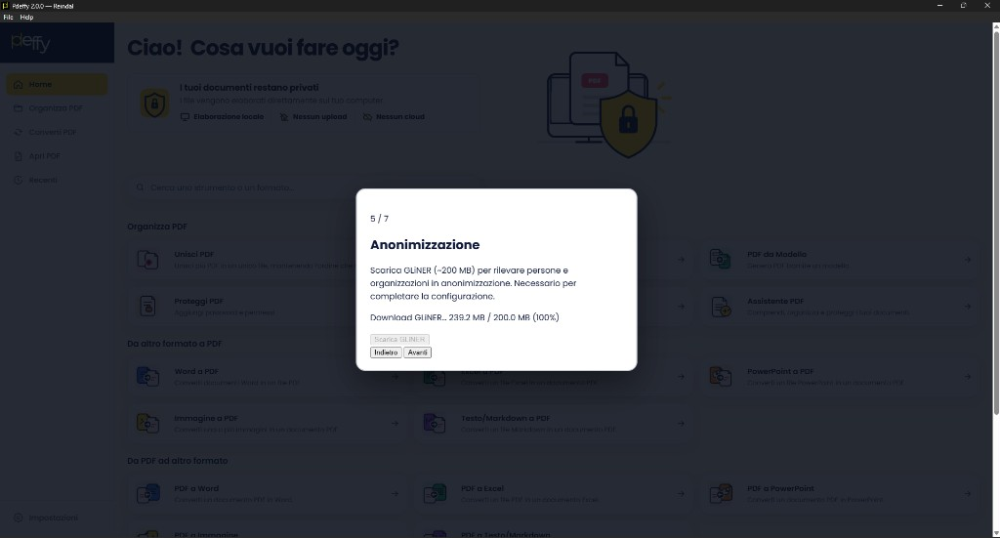
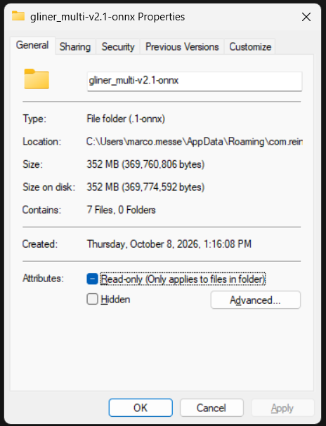

# QA — Bug fixati / chiusi

Stati `fixato`, `verificato`, `wontfix` e `duplicato`. Indice: [QA Bugs](QA-bugs.md). Aperti: [QA-open-bugs.md](QA-open-bugs.md).

## Riepilogo

| ID | Versione | Area | Titolo | Severity | Stato | Ipotesi |
|----|----------|------|--------|----------|-------|---------|
| BUG-001 | 2.0.0 | Setup / GLiNER | Progress download supera i 200 MB (size label errata) | minor | fixato | sì |

---

## Bug

### BUG-001 — Progress download GLiNER supera i 200 MB

| Campo | Valore |
|-------|--------|
| Versione | 2.0.0 *(app installata — dichiarata dal tester)* |
| Area | Setup / Anonimizzazione (GLiNER) |
| Severity | minor |
| Stato | fixato |
| Data | 2026-10-08 |
| Ambiente | Windows, app installata da installer |

**Descrizione**

Durante lo step 5/7 del setup wizard (“Anonimizzazione”), il progresso del download GLiNER mostra un totale fisso di 200 MB. I byte scaricati superano quel totale (es. `239.2 MB / 200.0 MB (100%)`), quindi la barra/percentuale non riflette la realtà.

**Passi per riprodurre**

1. Avviare Pdeffy 2.0.0 installata e aprire il setup wizard.
2. Arrivare allo step Anonimizzazione (5/7).
3. Avviare “Scarica GLiNER”.
4. Osservare la riga di progresso durante/dopo il download.

**Atteso**

Totale e percentuale coerenti con la dimensione reale del pack (o almeno un totale aggiornato / “sconosciuto” se Content-Length non è affidabile).

**Osservato**

Progress tipo `Download GLiNER.. 239.2 MB / 200.0 MB (100%)` mentre il download continua oltre i 200 MB. La cartella installata `gliner_multi-v2.1-onnx` pesa ~352 MB su disco.

**Screenshot**

**Ipotesi / pista per il fix**

Il totale ~200 MB è hardcoded e sottostimato rispetto al pack reale (~350 MB). Nel codice locale compare come `NER_PACK_SIZE_LABEL` / `NER_PACK_EXPECTED_BYTES` in `src-tauri/src/ai/anonymize/ner/config.rs`, più le stringhe UI in setup/settings/`changeLang.js`. Va allineato il totale (e le copy “~200 MB”) alla size reale del modello, oppure usare Content-Length / size su disco.

**Note**

Fix: il totale della barra non è più 200 MB fissi. Prima del download si somma il `Content-Length` dei file ancora da scaricare; se un host non lo comunica, la UI mostra solo i byte scaricati, senza un tetto finto. Le label “~200 MB” sono aggiornate a “~350 MB”, in linea con la cartella misurata (~352 MB). Da riverificare in setup.
